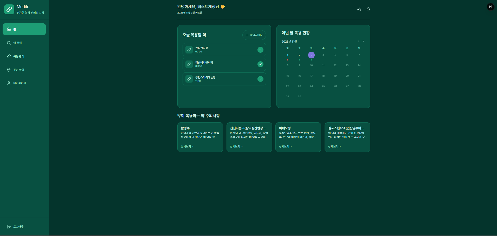
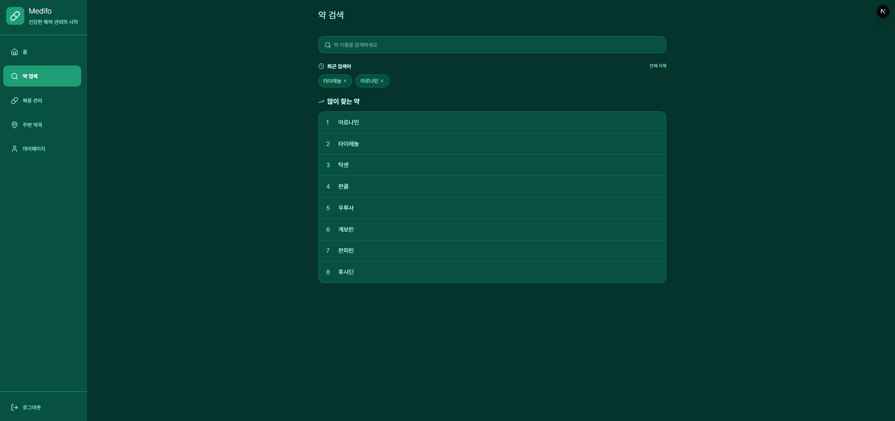
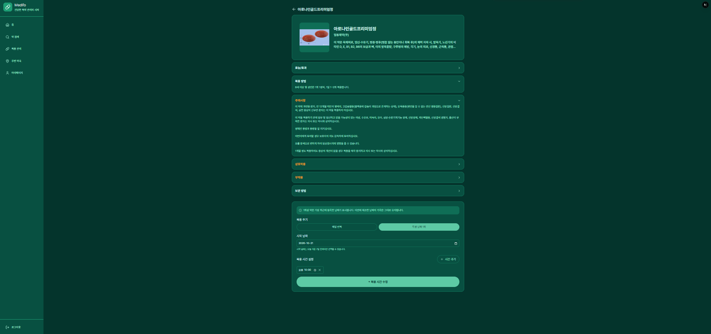
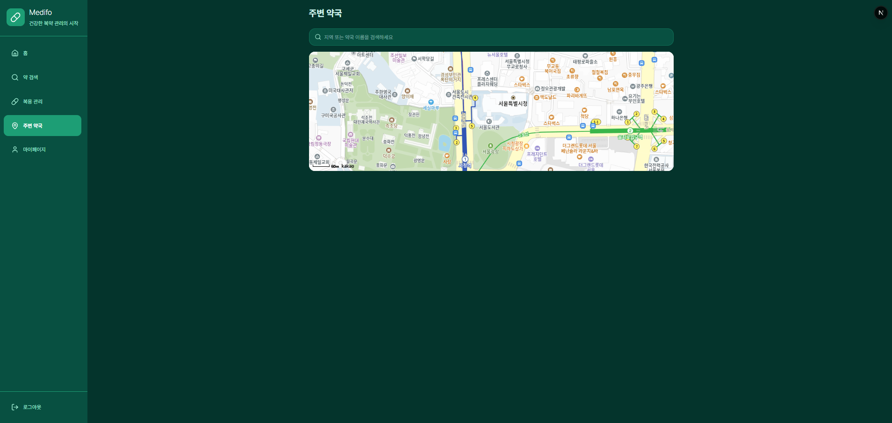
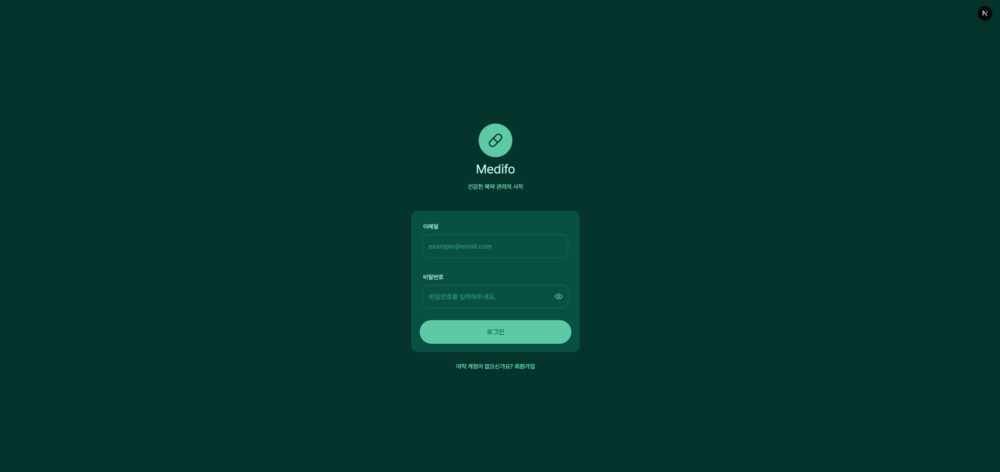
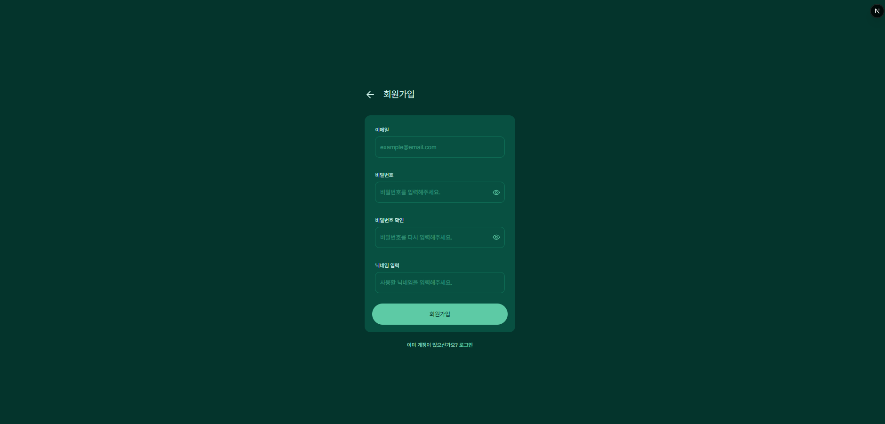
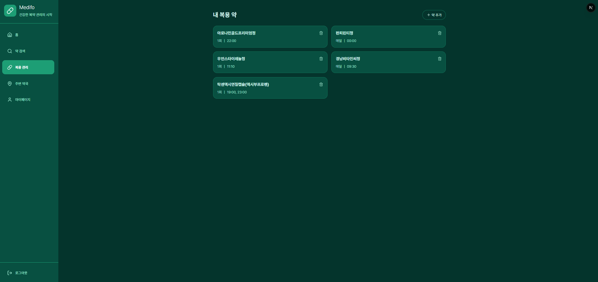
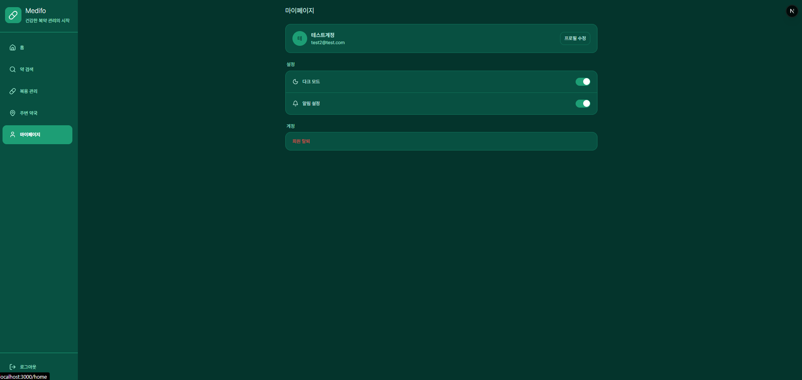

# Medifo

복용 중인 약과 복용 시간을 등록하고, 날짜별 복용 여부를 기록·확인하는 복약 관리 웹 서비스

- 식약처 e약은요 OpenAPI로 수집한 의약품 정보 검색, 카카오맵 기반 주변 약국 찾기 포함

## 배포 주소

- https://medifo-project.vercel.app (`main` 브랜치 배포)
- 로그인하지 않은 상태로 접속하면 로그인 화면으로 이동함

## 데모 계정

- ID: `test2@test.com`
- Password: `password!123`

자유롭게 체험할 수 있는 데모 계정이며 데이터는 초기화될 수 있음

## 화면

캡처는 다크 모드 기준이며 라이트 모드도 지원함

<table>
  <tr>
    <th>홈</th>
    <th>약 검색</th>
  </tr>
  <tr>
    <td></td>
    <td></td>
  </tr>
  <tr>
    <th>약 상세</th>
    <th>주변 약국</th>
  </tr>
  <tr>
    <td></td>
    <td></td>
  </tr>
</table>

<details>
<summary>로그인, 회원가입, 내 복용 약, 마이페이지</summary>

<table>
  <tr>
    <th>로그인</th>
    <th>회원가입</th>
  </tr>
  <tr>
    <td></td>
    <td></td>
  </tr>
  <tr>
    <th>내 복용 약</th>
    <th>마이페이지</th>
  </tr>
  <tr>
    <td></td>
    <td></td>
  </tr>
</table>

</details>

## 주요 기능

### 회원

- 이메일·비밀번호 회원가입, 로그인, 로그아웃 (Supabase Auth)
- 입력값 검증은 Zod 스키마로 처리하고 필드별 오류 문구 표시
- 로그인하지 않은 상태로 페이지에 들어가면 로그인 화면으로 이동하고, 로그인 후 원래 페이지로 돌아감
- 마이페이지에서 닉네임 수정, 다크 모드 전환, 회원 탈퇴

### 복용 관리

- 약 상세 화면에서 복용 등록·수정
  - 복용 주기: 매일 반복 / 특정 날짜 1회
  - 시작 날짜: 오늘 기준 7일 전까지 선택 가능
  - 복용 시간: 여러 개 추가 가능, 같은 시간 중복 추가 불가
- 등록하면 날짜·시간별 복용 일정을 생성함 (매일 반복은 오늘부터 90일치, 시작일이 미래면 시작일부터 90일치)
- 약 수정 시 이미 복용 완료로 체크한 날의 기록은 그대로 두고, 체크하지 않은 최근 7일과 오늘 이후 일정만 새 시간으로 바꿈
- 내 복용 약 목록에서 복용 주기와 시간 확인, 상세 화면 이동, 삭제

### 홈

- 오늘 복용할 약 목록과 시간별 복용 완료 체크
- 이번 달 복용 현황 달력
  - 초록 점: 그날 일정을 모두 복용함 / 빨간 점: 복용하지 않은 일정이 있음
  - 오늘은 예정 시각이 지난 일정만 기준으로 표시하고, 미래 날짜는 표시하지 않음
- 지난 날짜를 누르면 그날의 복용 기록을 보여주고, 최근 7일 기록은 복용 여부 수정 가능
- 많이 복용하는 약 주의사항 카드 4개 (등록한 사용자 수 기준 집계, 부족하면 기본 목록으로 채움)

### 약 검색

- 약 이름 부분 일치 검색, 전체 건수와 상위 50건 표시
- 최근 검색어 5개 (개별 삭제, 전체 삭제)
- 많이 찾는 약 키워드 8개 (검색한 사용자 수 기준 집계, 부족하면 기본 키워드로 채움)
- 약 상세: 효능·효과, 복용 방법, 주의사항, 주의사항 경고, 상호작용, 부작용, 보관 방법 중 값이 있는 항목만 표시
- 낱알 이미지가 없거나 불러오지 못하면 기본 아이콘 표시

### 주변 약국

- 첫 진입 시 현재 위치 기준으로 지도 표시 (위치 권한이 없으면 서울 기본 위치)
- 약국 이름 자동완성 (방향키·Enter로 선택 가능)
- 지역 검색: 주소 검색으로 지역 중심을 잡고, 결과가 5건 미만이면 반경을 1km → 3km → 5km로 넓혀 거리순으로 최대 15건 표시
- 약국을 고르면 선택한 약국과 주변 약국 3곳 표시

### 공통

- 페이지 이동 중 화면 모양의 스켈레톤 표시
- 라이트·다크 모드 (시스템 설정 기본)
- 키보드 포커스 시 서비스 색에 맞춘 포커스링 표시

## 기술 스택

버전은 `package.json` 기준

| 구분           | 사용 기술                                                            | 선택 이유                                                                                                            |
| -------------- | -------------------------------------------------------------------- | -------------------------------------------------------------------------------------------------------------------- |
| 프레임워크     | Next.js 16.2.9 (App Router), React 19.2.4                            |                                                                                                                      |
| 언어           | TypeScript ^5                                                        |                                                                                                                      |
| 스타일         | Tailwind CSS ^4.3.1                                                  |                                                                                                                      |
| 백엔드         | Supabase (`@supabase/supabase-js` ^2.108.2, `@supabase/ssr` ^0.12.0) |                                                                                                                      |
| 인증 처리 위치 | Next.js `proxy.ts`                                                   | 페이지에 들어가기 전 한 곳에서 인증 여부를 확인하기 위함. Next.js 16에서 `middleware.ts` 대신 권장되는 이름 (PR #26) |
| 입력값 검증    | Zod ^4.6.5                                                           | 정규식과 조건문으로 따로 작성하던 검증 규칙과 오류 문구를 스키마 한 곳에서 관리하기 위함 (PR #31)                    |
| 테마           | next-themes ^0.4.6                                                   |                                                                                                                      |
| 아이콘         | lucide-react ^1.21.0                                                 |                                                                                                                      |
| 지도           | 카카오맵 JavaScript SDK (services 라이브러리)                        |                                                                                                                      |
| 의약품 데이터  | 식약처 의약품개요정보(e약은요) OpenAPI                               |                                                                                                                      |
| 코드 품질      | ESLint ^9 (`eslint-config-next` 16.2.9), Prettier ^3.8.4             |                                                                                                                      |
| 패키지 매니저  | Bun (`bun.lock`)                                                     |                                                                                                                      |
| 배포           | Vercel                                                               |                                                                                                                      |
| 예약 작업      | GitHub Actions                                                       | Supabase 무료 플랜이 7일 동안 요청이 없으면 일시정지되는 것을 막기 위함 (PR #62)                                     |

## 폴더 구조

```
src/
├── app/
│   ├── (auth)/          로그인, 회원가입, 로그아웃
│   └── (main)/          로그인 후 화면 (홈, 약 검색, 약 상세, 내 복용 약, 주변 약국, 마이페이지)
│       └── */_components/   화면 전용 컴포넌트
├── components/
│   ├── layout/          사이드바
│   └── ui/              공용 컴포넌트 (모달, 입력창, 토스트, 약 이미지, 테마 전환)
├── schemas/             Zod 스키마
├── utils/
│   ├── intakeLogs/      복용 일정 생성, 수정 가능 기간 계산
│   └── supabase/        Supabase 클라이언트 (서버, 브라우저, 관리자, 세션 갱신)
└── proxy.ts             인증 확인과 세션 갱신
scripts/                 의약품 데이터 수집, 복용 일정 백필 (1회성)
.github/workflows/       Supabase 일시정지 방지 예약 작업
```

## 데이터와 보안 구조

### 인증

- `src/proxy.ts`에서 정적 파일을 뺀 모든 요청마다 Supabase `getUser()`를 호출해 세션을 갱신함
  - 로그인하지 않았으면 `/login?redirect=원래 경로`로 이동
  - 로그인한 상태로 `/login`, `/signup`에 들어가면 `/home`으로 이동
- 로그인 후 이동할 `redirect` 값은 내부 경로(`/`로 시작하고 `//`, `/\`로 시작하지 않는 값)일 때만 사용함

### Supabase 클라이언트

| 클라이언트 | 파일                       | 사용 위치                                                                |
| ---------- | -------------------------- | ------------------------------------------------------------------------ |
| 서버       | `utils/supabase/server.ts` | 서버 컴포넌트, 서버 액션 (쿠키 기반 로그인 사용자 권한)                  |
| 브라우저   | `utils/supabase/client.ts` | 클라이언트 컴포넌트 (로그인 사용자 권한)                                 |
| 관리자     | `utils/supabase/admin.ts`  | 서버 전용. 회원 탈퇴 시 `auth.users` 삭제, 집계 함수 호출, 수집 스크립트 |

- 관리자 클라이언트는 Secret key를 쓰고 RLS를 거치지 않으므로 서버 코드에서만 가져다 씀

### 테이블

| 테이블                | 내용                                                    |
| --------------------- | ------------------------------------------------------- |
| `users`               | 회원 프로필 (닉네임)                                    |
| `medicines`           | e약은요 수집 의약품 정보                                |
| `user_medicines`      | 사용자가 등록한 복용 약 (복용 주기, 시작일, 시간)       |
| `intake_logs`         | 날짜·시간별 복용 일정과 복용 여부 (`pending` / `taken`) |
| `user_search_history` | 최근 검색어 (`user_id`, `term` 조합당 1행)              |

- 테이블 정의, RLS 정책, DB 함수는 Supabase SQL Editor에서 직접 관리하고 저장소에는 마이그레이션 파일이 없음

### RLS와 서버 검증

- 공개 키로 로그인 없이 조회하면 `medicines`만 행이 조회되고 사용자 데이터 테이블은 0행이 조회됨 (PR #62에서 1회 확인)
- 서버 액션마다 `getUser()`로 로그인 사용자를 다시 확인하고, 로그인하지 않았으면 처리하지 않음
- 복용 여부 수정은 서버 액션에서 수정 가능 기간(오늘 기준 7일 전 ~ 오늘)을 다시 검사함
- 홈의 날짜 쿼리(`?date=`)는 형식과 과거 날짜 여부를 서버에서 다시 검사함
- 약 등록·수정·삭제, 최근 검색어 조회·삭제, 약 검색은 브라우저에서 Supabase로 직접 요청하므로 RLS에 의존함

### 집계 함수 (RPC)

- `get_popular_search_terms`: 검색한 사용자 수 기준 인기 검색어
- `get_popular_medicines`: 등록한 사용자 수 기준 인기 약과 주의사항
- 두 함수 모두 `security definer`, `search_path = ''`이고 `user_id`를 반환하지 않음 (PR #50)
- 실행 권한은 `service_role`에만 있어 서버의 관리자 클라이언트로만 호출함
- 사용자 3명 이상이 검색·등록한 항목만 집계함 (`src/utils/popularRanking.ts`의 `MIN_USERS`). 한 사람의 검색 기록이 다른 사용자에게 그대로 보이지 않게 하기 위함
- 결과는 `unstable_cache`로 1시간 캐시하고, 호출이 실패하면 기본 목록만 보여주며 실패 결과는 캐시하지 않음

## 문제 해결 사례

수치는 각 PR 본문에 기록한 측정값이고, 측정 환경도 PR 기준임

### 1. ESLint 오류·경고 27건 정리 (이슈 #51, PR #53)

- 문제
  - `bun run lint` 결과 27건 (오류 24, 경고 3)
- 원인 (규칙별)
  - `no-explicit-any` 21건: 약국 페이지에서 카카오맵 SDK 객체와 검색 결과를 타입 없이 `any`로 사용
  - `react-hooks/set-state-in-effect` 3건, `react-hooks/exhaustive-deps` 2건, `no-unused-vars` 1건
- 해결
  - 규칙을 끄거나 `eslint-disable` 주석을 쓰지 않고 코드를 고침
  - 카카오 SDK에서 실제로 쓰는 생성자·메서드·결과 필드만 `pharmacy/kakao.ts`에 직접 타입 선언 (타입 패키지 추가 없음)
  - effect 안의 setState는 `useState` 초기값과 `ignore` 플래그로 바꾸고, 지도 검색 함수는 `useEffectEvent`로 감쌈
  - 3곳에 중복 선언된 약국 타입을 `pharmacy/types.ts` 하나로 모음
- 전후 수치
  - 린트 27건 → 0건, `bun run build` 통과
  - 변경 파일 10개, +276 / −216, 커밋 5개
  - 직접 확인 17개 항목 통과
- 함께 바뀐 동작
  - 약 등록 화면: 서버가 다시 렌더해도 입력 중인 값을 덮어쓰지 않음
  - 최근 검색어: 화면을 벗어난 뒤 늦게 도착한 응답을 무시함
- 확인하지 못한 것
  - 자동 테스트 없이 직접 확인한 결과임

### 2. 지역 약국 검색 결과 누락 (이슈 #52, PR #54)

- 문제
  - 지역명으로 검색하면 그 지역 안의 약국이 결과에서 빠짐
- 원인
  - 지역 중심이 지역 자체가 아니라 "지역명 + 약국" 키워드 검색 1번 결과(약국 위치)로 잡힘
  - 반경이 1km로 고정되어 약국이 드문 읍·면을 커버하지 못함
- 해결
  - 중심 좌표를 `Geocoder.addressSearch` 첫 결과로 바꾸고, 주소 결과가 없을 때(약국 이름, 역 이름 등)만 기존 키워드 검색 사용
  - 결과가 5건 미만이면 반경을 1km → 3km → 5km로 넓힘. 단계마다 최신 요청인지 확인해 이전 결과가 늦게 덮어쓰지 않게 함
  - 거리순 정렬, 결과 0건이면 목록과 마커 비움
  - 기준 건수는 처음 3건으로 넣었다가 흥업면 실측(약국 하나가 면 중심에서 3,034m라 3km 단계에서 빠짐)을 보고 5건으로 바꿈
- 전후 수치 (로컬, 카카오 API 직접 호출, 입력마다 1회. 표시 최대 15건 중 주소가 해당 지역인 약국 수)
  - 흥업면: 지역 안 약국 2곳 중 1곳 → 2곳 (표시 1건 → 15건)
  - 무실동: 1건 → 14건
  - 역삼동: 6건 → 13건
  - 약국 이름 검색: 표시 1건 → 15건, 해당 약국은 첫 번째 그대로
  - 변경 파일 2개, +111 / −41, 커밋 4개, 직접 확인 9개 항목 통과
- 확인하지 못한 것
  - 배포 사이트 결과는 확인하지 않음 (로컬 기준)
  - 흥업면 약국 2곳은 카카오 검색으로 찾은 수이고 실제 전체 수는 확인하지 않음
  - 반경 상한이 5km라 넓은 지역에서는 지역 안 약국 전체를 보장하지 않음

### 3. 복용 일정 생성과 달력 표시 범위 (이슈 #55, PR #56)

- 문제
  - 시작일을 7일보다 이전으로 등록하면 그 구간의 달력에 복용 여부 점이 표시되지 않음
  - 약 시간을 수정하면 이미 복용 완료로 체크한 날이 빨간 점(미복용)으로 바뀜
- 원인
  - 복용 기록이 오늘 기준 7일 전부터만 생성되도록 되어 있어 그 이전 구간은 기록 자체가 없었음. 달력은 해당 월 전체를 조회하고 있어 조회 쪽 문제는 아님
  - 약 수정 시 지난 날짜까지 새 시간으로 다시 만들면서, 체크한 날에 옛 시간(복용 완료)과 새 시간(미복용)이 함께 생김
- 해결
  - 시작일을 오늘 기준 7일 전까지만 고를 수 있게 제한 (날짜 선택기 `min`, 안내 문구, Zod 검증에 같은 상수 사용)
  - 7일보다 오래된 기록은 수정 시 건드리지 않음
  - 최근 7일 안에서 체크한 기록이 있는 날은 그대로 두고, 없는 날만 새 시간으로 교체
  - 날짜별 체크 여부는 조회 1번으로 판단하고, 요청 수는 3번(조회, 삭제, upsert)으로 기존과 같음
- 전후 수치 (로컬, 2026-10-27 ~ 10-28 측정)
  - 수정 전: 시작일 10-07 약의 기록이 10-15부터만 있어 8일치가 없음
  - 수정 전: 10-21에 체크한 시간 1행과 새 시간 1행이 함께 생겨 빨간 점으로 표시됨
  - 시뮬레이션 경계 사례 15개 모두 의도한 결과와 일치
  - 실제 DB 시험 약에서 1회성으로 바꿨을 때 184행 → 4행, 복용 완료 기록 4행은 모두 유지
  - 변경 파일 4개, +154 / −63, 커밋 5개, 직접 확인 12개 항목 통과
- 확인하지 못한 것
  - 배포 사이트 결과는 확인하지 않음 (로컬 기준)

### 4. 키보드 포커스링과 키보드 접근 (이슈 #59, PR #60)

- 문제
  - Tab 이동 시 브라우저 기본 검정 포커스링이 나와 서비스 디자인과 맞지 않음
  - 복용 시간·시작 날짜 입력은 `outline-none`만 있어 포커스가 보이지 않음
  - 약국 자동완성 목록에서 링이 잘림
  - 내 복용 약 카드는 키보드로 포커스할 수 없음
- 원인
  - 전역 포커스 스타일이 없어 브라우저 기본 링이 그대로 나옴
  - 자동완성 목록의 `overflow-y-auto`가 항목 바깥에 그려지는 링을 잘라냄
  - 카드가 `onClick`만 있는 `div`라 키보드 포커스를 받지 못함
- 해결
  - `:focus-visible`에만 전역 outline을 적용해 마우스 클릭 때는 링이 나오지 않게 함. 색은 라이트 #534ab7, 다크 #cecbf6
  - 링 색 대비비를 배경 7종에 대해 계산해 모두 WCAG 비텍스트 대비 기준 3:1 이상 (최저 3.99)
  - 자동완성 항목은 링을 항목 안쪽에 그림
  - 카드 전체를 덮는 링크를 두고 삭제 버튼은 그 위에 형제로 둠 (버튼 안에 버튼을 넣지 않음)
- 전후 수치 (로컬, Chrome, 각 1회)
  - 포커스 표시 없는 입력: 2곳 → 0곳
  - 약국 자동완성 링 잘림: 15개 중 15개(다크) → 0개 (라이트 전 값 미측정)
  - 내 복용 약 Tab 순서: 카드 0개 → 카드 3개 모두 포커스 가능
  - 수정 후 화면별 포커스 가능한 요소(홈 45, 검색 21, 약 상세 19, 내 복용 약 13, 마이페이지 10, 약국 8)에서 라이트·다크 모두 링 잘림 0개
  - 변경 파일 8개, +56 / −28, 커밋 8개, 직접 확인 12개 항목 통과
- 확인하지 못한 것
  - 로그인·회원가입 화면, Safari·Firefox, 배포 사이트, 스크린 리더 낭독
  - 모달이 열려도 포커스가 모달 안으로 이동하지 않는 문제는 남아 있음

## 프로젝트 규모

기준: 2026-11-03, `dev` 브랜치 커밋 `51e61b4` (README 작업 커밋은 포함하지 않음)

| 항목                 | 값                                             | 측정 방법                                                                    |
| -------------------- | ---------------------------------------------- | ---------------------------------------------------------------------------- |
| 기간                 | 2026-06-12 ~ 2026-11-03                        | `git log --reverse --format=%cs origin/dev` 첫 줄과 기준 커밋 날짜           |
| 커밋                 | 185개 (merge 커밋 제외 154개)                  | `git rev-list --count origin/dev`, `--no-merges`                             |
| PR                   | 31개 (모두 머지)                               | `gh pr list --state all`                                                     |
| 이슈                 | 32개 (닫힘 31, 열림 1)                         | `gh issue list --state all`                                                  |
| `src`의 ts·tsx 파일  | 82개 (내용 없는 파일 3개 포함)                 | `git ls-files 'src/*.ts' 'src/*.tsx'`                                        |
| `src`의 ts·tsx 줄 수 | 4,415줄 (빈 줄·주석 포함)                      | 위 파일을 합쳐 `wc -l`                                                       |
| 화면 (`page.tsx`)    | 11개 (`/` 로그인 이동, 알림 준비 중 화면 포함) | `git ls-files 'src/*page.tsx'`                                               |
| 서버 액션 파일       | 8개                                            | `'use server'`로 시작하는 파일                                               |
| 의약품 데이터        | 4,757건 (낱알 이미지 없음 1,979건)             | Supabase REST `medicines` 조회 `Prefer: count=exact`                         |
| 테스트               | 0개                                            | `.test`, `.spec`, `__tests__` 파일 검색. `package.json`에 test 스크립트 없음 |

## 개발 예정

아직 구현되지 않은 항목 (저장소 코드에서 확인)

- 알림
  - 마이페이지 알림 설정 토글은 화면 상태로만 동작하고 저장되지 않음
  - `/notifications`는 "준비 중" 문구만 있고, 홈 상단 알림 아이콘은 눌러도 동작 없음
- 교차복용 검사
  - 검사 로직 없음
  - 약 상세의 병용금기 안내 영역은 있으나 수집 데이터에 병용금기 값이 0건이라 표시되지 않음
- 복용 종료 처리
  - `is_active`를 `false`로 바꾸는 코드가 없어 복용 종료 개념이 없음
  - 지금은 약을 삭제하면 확인 창 없이 바로 삭제되고, 연결된 복용 기록도 함께 삭제됨 (FK CASCADE, PR #41)
- 약별 메모: 관련 컬럼과 화면 없음
- 낱알 이미지 보완: 4,757건 중 1,979건이 이미지 없음
- 목록 페이지 나누기
  - 약 검색 결과는 상위 50건까지만 표시
  - 약국 지역 검색은 첫 페이지(최대 15건)만 표시하고, 결과 0건일 때 안내 문구 없음
- 키보드 접근 남은 부분
  - 모달이 열려도 포커스가 모달 안으로 이동하지 않음
  - 최근 검색어 개별 삭제(X)와 약국 검색 결과 항목은 마우스로만 누를 수 있음
- 복용 기록 재생성(조회, 삭제, upsert)을 하나의 트랜잭션으로 처리
- 스키마와 RLS 정책을 SQL 파일로 저장소에 포함 (현재는 Supabase SQL Editor에서 직접 관리)
- 테스트 코드

## 실행 방법

### 준비

- Bun
- Supabase 프로젝트 (위 테이블과 집계 함수가 있어야 함, 저장소에 스키마 파일 없음)
- 카카오 개발자 JavaScript 키 (주변 약국)
- 공공데이터포털 서비스 키 (의약품 데이터 수집 스크립트를 실행할 때만)

### 환경변수

프로젝트 루트에 `.env.local`을 만들고 아래 이름으로 값을 넣음 (`.env.example` 파일은 없음)

| 이름                                   | 용도                            | 사용 위치                            |
| -------------------------------------- | ------------------------------- | ------------------------------------ |
| `NEXT_PUBLIC_SUPABASE_URL`             | Supabase 프로젝트 주소          | Supabase 클라이언트 전체             |
| `NEXT_PUBLIC_SUPABASE_PUBLISHABLE_KEY` | Supabase 공개 키                | 서버, 브라우저 클라이언트, 세션 갱신 |
| `SUPABASE_SECRET_KEY`                  | Supabase Secret key (서버 전용) | 관리자 클라이언트                    |
| `NEXT_PUBLIC_KAKAO_MAP_KEY`            | 카카오맵 JavaScript 키          | 주변 약국 지도                       |
| `DATA_GO_KR_SERVICE_KEY`               | 공공데이터포털 서비스 키        | `scripts/syncMedicines.ts`           |

### 명령어

```bash
bun install
bun dev            # http://localhost:3000
bun run build
bun run lint
bun run format     # Prettier 검사 (format:fix로 수정)
```

### 의약품 데이터 수집 (1회성)

스크립트 파일 주석에 적힌 실행 방법 (`tsx`는 `package.json`에 없어 `npx`로 실행)

```bash
# DB 쓰기 없이 소량 점검
npx tsx --env-file=.env.local scripts/syncMedicines.ts --dry-run --rows=25 --pages=1
# 전체 수집 (item_seq 기준 upsert라 다시 실행해도 됨)
npx tsx --env-file=.env.local scripts/syncMedicines.ts
```

### GitHub Actions 시크릿

`.github/workflows/supabase-keepalive.yml`(3일마다 실행)에 필요함

- `SUPABASE_URL`, `SUPABASE_ANON_KEY`, `SUPABASE_PING_TABLE`
